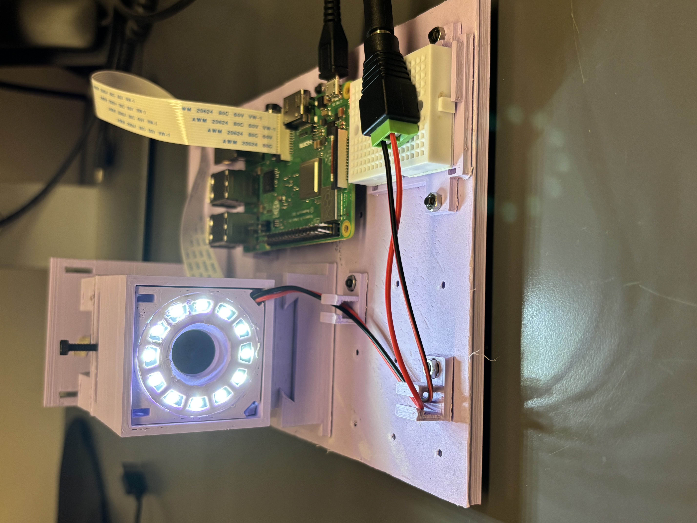
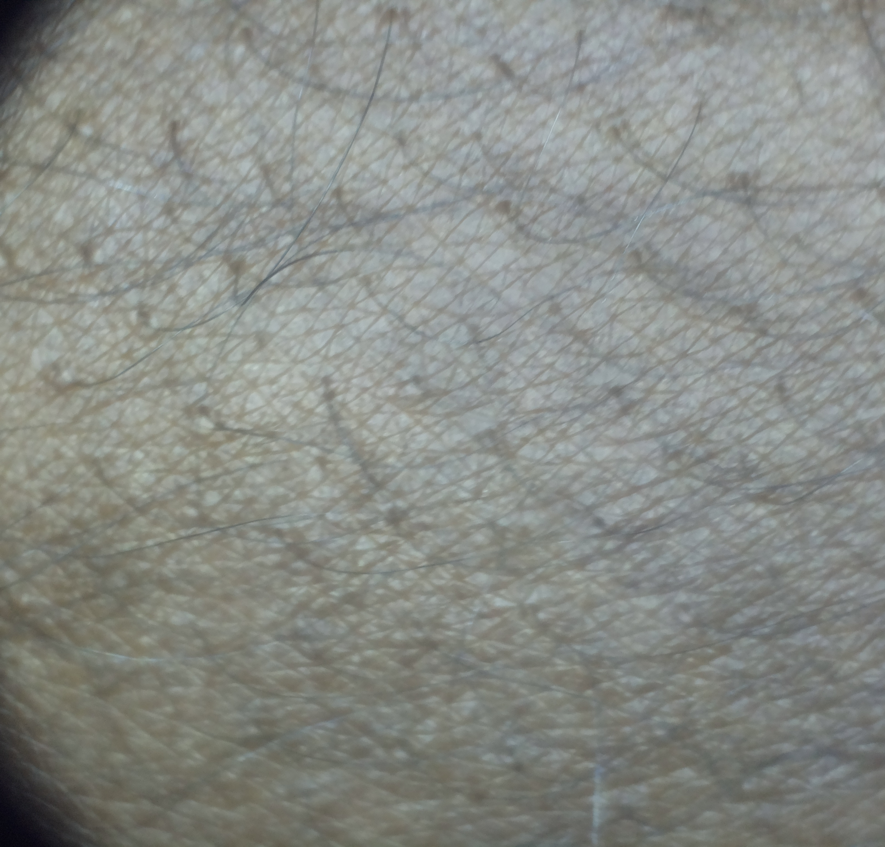
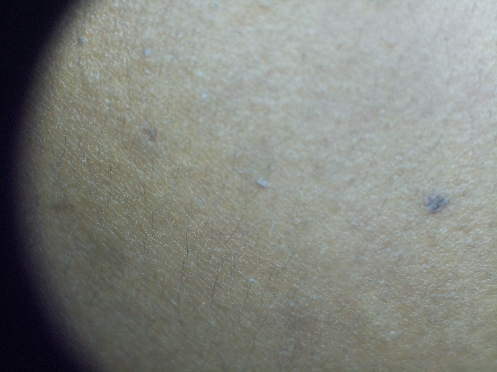

# TONA Lux

**A compact optical imaging system for high-resolution skin imaging.**

TONA Lux is a custom-built skin imaging device that uses a single-lens optical system and cross-polarized illumination to capture magnified images of skin structures and lesions.
With a 5 cm non-contact working distance, the system allows skin imaging without direct contact supporting easier sharing of the device between users while reducing contact-related hygiene concerns.

The system is being developed to support on-device AI for real-time lesion processing and longitudinal skin monitoring.

## Prototype

## Sample Skin Images

The following images were captured using the TONA Lux prototype.

| Sample 1 | Sample 2 | Sample 3 |
|---|---|---|
|  |  |  |

These initial captures demonstrate the system's ability to resolve fine skin textures and surface details under controlled illumination.

## Technical Overview

- Single-lens optical design
- Cross-polarized LED illumination
- Magnified close-up skin imaging
- **5 cm non-contact working distance**, allowing skin imaging without direct contact. This design supports easier sharing of the device between users while reducing contact-related hygiene concerns.
- Local image acquisition and processing
- Planned integration of on-device AI models

## Code & Contributions
Detailed optical specifications, hardware configurations, and implementation details are not publicly disclosed at this stage.

If you're interested in learning more about TONA Lux, collaborating, or contributing to its development, feel free to reach out to me privately at **delyce_twizeyimana@brown.edu**.

## Acknowledgments
Special thanks to Professor Jonghwan Lee of Brown University for generously providing the optical lenses used in developing and testing the TONA Lux prototype. His support made it possible to explore and test different optical configurations.

---

## Known Issues

Since most components, including the **lens holder**, are 3D-printed, and the polarizers were manually cut without specialized tools, the current prototype has some optical limitations. The relatively small lens diameter may also contribute to these issues.

The following are known issues I am actively working to address:

- **Vignetting:** Noticeable darkening around the edges of captured images, potentially caused by the small lens diameter or limitations in the 3D-printed lens holder.
- **Uneven illumination:** Inconsistent brightness across the imaging area, potentially due to imperfectly cut polarizers and LED positioning.
- **Optical alignment:** Small inaccuracies in 3D-printed components, particularly the lens holder, may affect optical alignment and image quality.

These limitations will be addressed in future iterations of TONA Lux.

*TONA Lux is an experimental research prototype and is not intended for medical diagnosis.*
