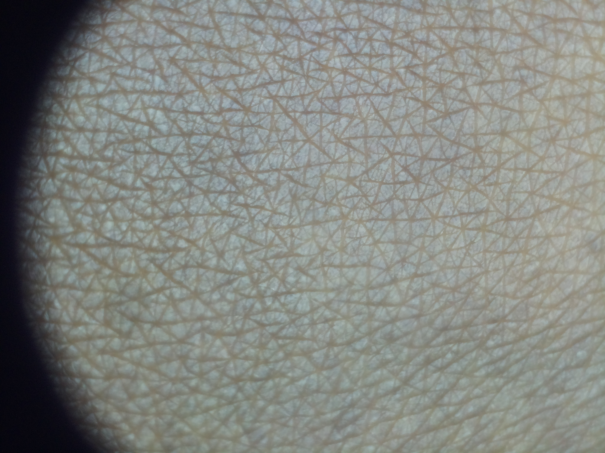

# TONA Lux

**A compact optical imaging system for high-resolution skin imaging.**

TONA Lux is a custom-built skin imaging device that uses a single-lens optical system and cross-polarized illumination to capture magnified images of skin structures and lesions.

The system is being developed to support on-device AI for real-time lesion processing and longitudinal skin monitoring.

## Prototype

## Sample Skin Images

The following images were captured using the TONA Lux prototype.

| Sample 1 | Sample 2 | Sample 3 |
|---|---|---|
|  |  |  |

These initial captures demonstrate the system's ability to resolve fine skin textures and surface details under controlled illumination.

## Technical Overview

- Single-lens optical design
- Cross-polarized LED illumination
- Magnified close-up skin imaging
- **5 cm non-contact working distance**, allowing skin imaging without direct contact. This design supports easier sharing of the device between users while reducing contact-related hygiene concerns.
- Local image acquisition and processing
- Planned integration of on-device AI models

Detailed optical specifications, hardware configurations, and implementation details are not publicly disclosed at this stage.

**For technical details or potential research collaborations, please reach out to me directly.**

## Acknowledgments

Special thanks to **Professor Jonghwan Lee** for generously providing the optical lenses used in developing and experimenting with this prototype. His support made it possible to explore and test different optical configurations.

---

*TONA Lux is an experimental research prototype and is not intended for medical diagnosis.*
